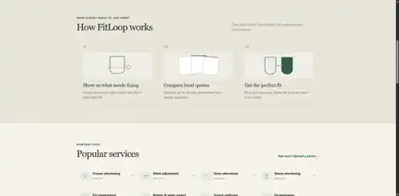
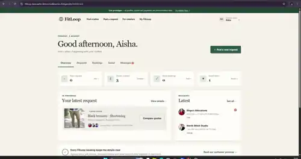

# FitLoop — Clothing Alterations Marketplace

**Interactive product prototype · Generating Genius Entrepreneurship Genius 2026**

**[View the original demo domain](https://tryfitloop.co.uk)** · **[Competition and award](COMPETITION.md)** · **[Technical report](PROJECT_REPORT.md)** · **[Personal portfolio case study](https://github.com/ahmedmadkour-dev/ahmedmadkour-dev/tree/main/portfolio/fitloop)**

> FitLoop was a live *demonstration* presented during a competition, not a trading marketplace with real transactions. The original domain's availability may change.

## Why FitLoop?

Sometimes clothing is returned or left unworn because it needs a small alteration. Our team's idea was to make it easier for customers to discover local tailors, describe what they need, compare indicative prices and track the job.

## My role

As the team's **product designer and website builder**, I created the interactive demonstration, worked through the customer journey and interface, iterated on features and presentation, and bought the domain for a public pitch demo. I designed and contributed to the competition slides and participated in the pitch and Q&A.

The competition was a **team project**, and this describes the work I personally contributed.

## What I built into the demonstration

- Responsive marketplace-style landing page and tailor profile discovery
- Filters by area, alteration type and other demonstration criteria
- Saved tailor profiles and multi-step request flow
- Example quote comparison and acceptance
- Booking progress and customer/tailor dashboards
- Simulated messaging and a retailer alteration journey

### Customer dashboard

The records shown were **demonstration data**, not real customers, paid bookings or messages delivered to tailors.

## Competition and recognition

FitLoop was presented on **5 September 2026** at the **Generating Genius Entrepreneurship Genius** competition. Although our team did not win the overall competition, I received an **Outstanding Individual award** for my contribution.

I learnt how much stronger a pitch becomes when judges can interact with a product. I also learnt to prepare more rigorous evidence for commercial assumptions after being questioned on our investment valuation.

[Read the competition case study](COMPETITION.md)

## Technical snapshot

**Technologies documented:** TypeScript/React, Vite/vinext conventions, Tailwind CSS and Cloudflare tooling.

The goal was a usable product demonstration: demo state was local, and the project did not deliver production multi-user authentication, real payments, live quotes or a shared marketplace database. The full application source is not currently published in this repository; it includes project documentation and original screenshots.

**Development approach:** I directed the requirements, interface, user journeys, iterations and deployment, using coding tools to help implement and revise substantial parts of the prototype. The [technical report](PROJECT_REPORT.md) describes the scope and limitations.

## Next iteration

If I take FitLoop further, the priorities are interviews with tailors and customers, a small pilot, pricing and operational validation, and only then production authentication, bookings and transaction handling.
